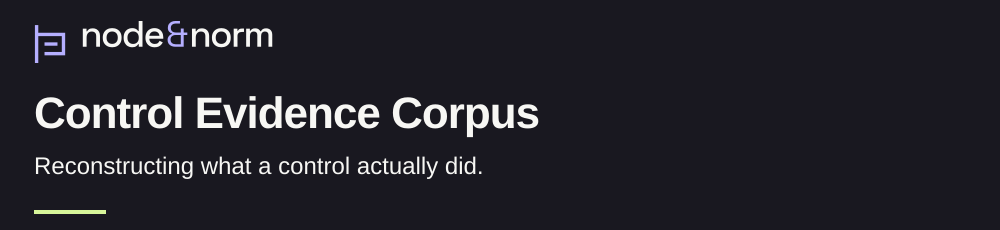

<h1>
<picture>
  <source media="(max-width: 600px)" srcset="assets/research/v1/banner-mobile-dark.svg">
  
</picture>
</h1>

[](docs/research-summary.md) [](https://github.com/node-and-norm/node-norm-control-evidence/releases/tag/v0.3.0-dev) [](examples/README.md)

What can surviving records establish about whether an AI control operated? The Control Evidence Corpus (CEC) connects a control question to its sources, recorded actions and unresolved evidence. [Research question and contribution](docs/research-summary.md).

[Policy reader: understand in 90 seconds](#research-in-90-seconds) · [Reviewer: inspect the evidence](docs/current-review.md) · [Engineer: run the checks](docs/reference-verification.md)

## At a glance

| | Current account |
| :--- | :--- |
| Purpose | Reconstruct individual control opportunities from incomplete public evidence. [Research brief](research/README.md) |
| Status | Development infrastructure. The empirical pilot remains pending. [Decision gates](research/README.md#decision-gates) |
| Evidence type | Three synthetic demonstrations, an unrated source map and separate development experiments. [Evidence guide](docs/current-review.md#evidence-to-read) |
| Version | 0.3.0-dev, released October 3, 2026. [Citation metadata](CITATION.cff), [release](https://github.com/node-and-norm/node-norm-control-evidence/releases/tag/v0.3.0-dev) |
| License | Blanket corpus license unselected; source-specific restrictions apply. [Rights ledger](docs/policies/RIGHTS_LEDGER.md) |
| Cite | Exact development commit and infrastructure status. [Existing citation record](CITATION.cff) |

The repository contains **zero independently coded empirical events** and **no approved empirical corpus release**. Its runnable examples use invented records. [Current scope](docs/research-summary.md), [example gallery](examples/README.md).

## Research in 90 seconds

A recorded override raises three questions: was an action attempted, did it reach the system and did it reduce the harm? CEC preserves each question separately. Its demonstrations distinguish a command without acknowledgement, a command with a stop acknowledgement and a policy with no runtime record. [Synthetic dossiers](examples/README.md).

The proposed contribution is a reproducible way to reconstruct individual control opportunities from incomplete evidence. Each observation binds one event, one control objective, one opportunity and one relevant period. Source assertions and researcher judgments occupy separate records. Missing evidence retains an explicit state. [Codebook](docs/methods/CODEBOOK.md), [research brief](research/README.md).

The comparative pilot will test whether this structure improves supported reconstruction against a narrative and a checklist. Independent study roles and acceptance thresholds remain unfilled. The work's practical value depends on that evaluation. [Pilot design](research/COMPARATIVE_PILOT_DESIGN.md), [known overlaps](research/NOVELTY_REVIEW.md).

## Method in brief

```mermaid
flowchart LR
  accTitle: CEC evidence reconstruction and planned review
  accDescr: Source assertions support a bounded event and control record. The record separates action, propagation and mitigation questions. Independent ratings and adjudication remain planned requirements before an empirical release.
  A["Sources and<br/>located assertions"] -->|supports| B["Bounded event<br/>and control record"]
  B -->|separates| C["Action, propagation<br/>and mitigation questions"]
  C -->|requires planned| D["Independent ratings<br/>and adjudication"]
  D -->|gates future| E["Empirical release<br/>with retained uncertainty"]
```



The text sequence is: locate sources, define a control opportunity, separate the three questions, obtain independent ratings and preserve disagreement through adjudication. Adjudication is a documented resolution of competing ratings. Independent review and empirical release remain future gates. [Codebook](docs/methods/CODEBOOK.md), [reliability plan](docs/methods/RELIABILITY_PLAN.md), [release requirements](research/README.md#decision-gates).

## Evidence and known limits

| Material | What is available | What remains open |
| :--- | :--- | :--- |
| Synthetic examples | Three invented demonstrations of the record structure and missingness rules. [Gallery](examples/README.md) | Empirical control operation and human reliability remain unmeasured. [Data statement](docs/policies/DATA_STATEMENT.md) |
| Source reconnaissance | A Tempe evidence map with bounded control questions. [Reconnaissance note](research/reconnaissance/tempe.md) | Independent human review remains pending; the note supplies no authoritative empirical labels. [AI-use disclosure](docs/policies/AI_USE_POLICY.md#development-disclosure) |
| Scripted sandbox | Sixteen authored TAE/HIT development conditions and saved runs. [Run index](experiments/us-control-sandbox/RUN-INDEX.md) | These conditions remain outside the empirical corpus. [Publication record](experiments/us-control-sandbox/PUBLICATION.md) |
| Model experiments | Preserved live model outputs on synthetic packets and AI-authored references. [Experiment index](experiments/jev-cec/README.md) | Model agreement leaves independent human validity and reliability unestablished. [Interpretation limits](docs/research-summary.md#limits-and-next-evidence) |
| Missingness design | Eight proposed packets and a 32-response mock rehearsal. [Design and scope](experiments/jev-cec/missingness-boundary-001/RUNNER.md) | The design has no live model results. |

Each instruction package alone matched the authored reference on 11 of 96 jointly valid judgments. Another 24 pairs were unavailable. This produces no net paired advantage for the shorter instructions within that run. The result leaves general accuracy, equivalence and human benefit unestablished. [Recorded comparison](experiments/jev-cec/instruction-comparison-001/LIVE-RESULTS.md).

## Reproduce the checks

Use Python 3.11 for the recorded checks, with the pinned dependency. The [verification guide](docs/reference-verification.md) gives exact commands and expected outputs for schema validation, dossier rendering, integrity tests and synthetic export. It runs builders in a disposable clone because they regenerate tracked examples. [Existing reproducibility guide](docs/reference/REPRODUCIBILITY.md), [CI workflow](.github/workflows/validate.yml).

## AI assistance and human review

Codex assisted implementation, literature screening, invented examples, pilot instruments and source reconnaissance. Jev supplied experiment outputs; the authored reference answers remain separately identified. Authoritative labels in the planned primary study require eligible independent human assessors. [AI-use policy](docs/policies/AI_USE_POLICY.md), [experiment records](experiments/jev-cec/README.md).

Exposure to an AI suggestion changes a rating's independence status. The policy requires disclosure of that exposure and reserves unassisted initial ratings for the planned human study. Current synthetic labels carry no human-research-judgment claim. [Human judgment requirements](docs/policies/AI_USE_POLICY.md#independent-human-judgments), [program disclosure](https://nodeandnorm.org/about/research-integrity/#ai-use).

## Citation

The entry below renders the identity in the existing [CITATION.cff](CITATION.cff). Record the exact Git commit used alongside it, as the citation message requires. The development version has no dataset DOI. [Distribution limits](docs/policies/DATA_STATEMENT.md#distribution-and-citation).

```bibtex
@software{banasihan2026controlcorpus,
  author = {Banasihan, Mark Julius},
  title = {Node \& Norm Control Evidence Corpus: research infrastructure},
  version = {0.3.0-dev},
  date = {2026-10-03},
  year = {2026},
  url = {https://github.com/node-and-norm/node-norm-control-evidence/releases/tag/v0.3.0-dev},
  note = {Unvalidated infrastructure development version. Cite the exact commit used.}
}
```

<details>
<summary>Complete prior entry, documentation and study preparation</summary>

The [complete prior README](README-2026-11-03.md) preserves the entry at [audit commit f05db6c](https://github.com/node-and-norm/node-norm-control-evidence/tree/f05db6c812eefb36452c11929767760f702245dc). It retains the development figures, experiment account and repository catalog.

- [Documentation index](docs/README.md)
- [Research charter](RESEARCH_CHARTER.md)
- [Pilot workbench](research/pilot/README.md)
- [Sampling plan](docs/methods/SAMPLING_PLAN.md)
- [Downstream integration contract](docs/reference/INTEGRATION_CONTRACT.md)
- [Rights ledger](docs/policies/RIGHTS_LEDGER.md)
- [Contribution policy](CONTRIBUTING.md)

</details>
